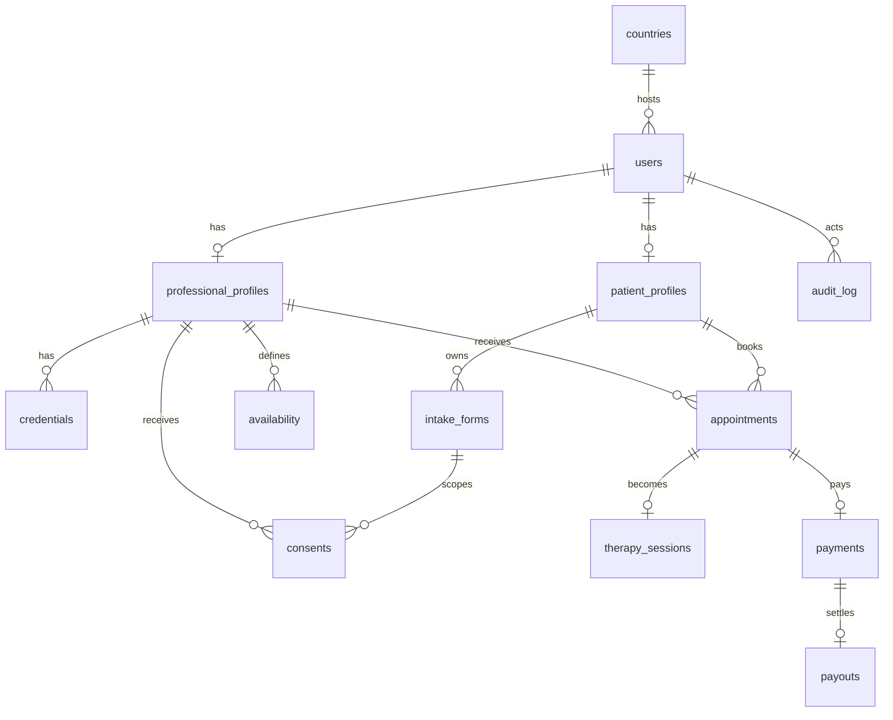

# Esquema de base de datos (Etapa 2)

**Requisitos:** REQ-ARCH-05, REQ-ARCH-06, REQ-SEC-02, REQ-SEC-03, REQ-ROLE-01..03

## Diagrama ER

## Tablas principales

| Tabla | Notas |
|-------|--------|
| `users` | Rol (`patient` \| `professional` \| `admin`), MFA cifrado, auth Auth.js |
| `auth_sessions` | Sesiones Auth.js (no confundir con `therapy_sessions`) |
| `intake_forms` | Contenido cifrado AES-256-GCM |
| `consents` | Alcance `intake_form_share`, `revoked_at` nullable |
| `therapy_sessions` | Notas profesionales cifradas |
| `audit_log` | Solo INSERT (trigger bloquea UPDATE/DELETE) |

## Migraciones

Orden en `packages/db/drizzle/`:

1. `0000_initial.sql` — esquema Drizzle  
2. `0002_audit_immutable.sql` — trigger `audit_log`  
3. `0003_rls.sql` — políticas RLS  
4. `0004_app_role.sql` — rol `telehealth_app`  

Comando: `DATABASE_URL=... pnpm --filter @telehealth/db db:migrate`

## Seeds anonimizados

`pnpm --filter @telehealth/db exec tsx src/seed/run-seed.ts` (tras migrar).

Usuarios demo: `paciente.a@example.test`, `paciente.b@example.test`, `profesional@example.test` (contraseña documentada solo para entornos locales de prueba en README del paquete db).

## RLS

Contexto por transacción: `app.user_id`, `app.role`, opcional `SET LOCAL ROLE telehealth_app`.